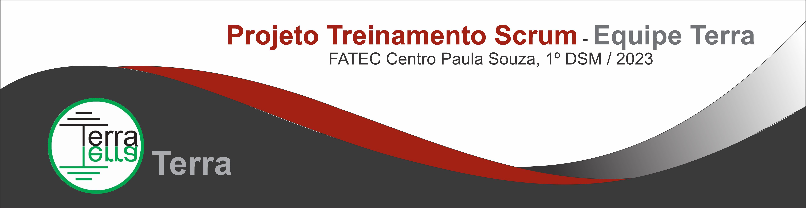
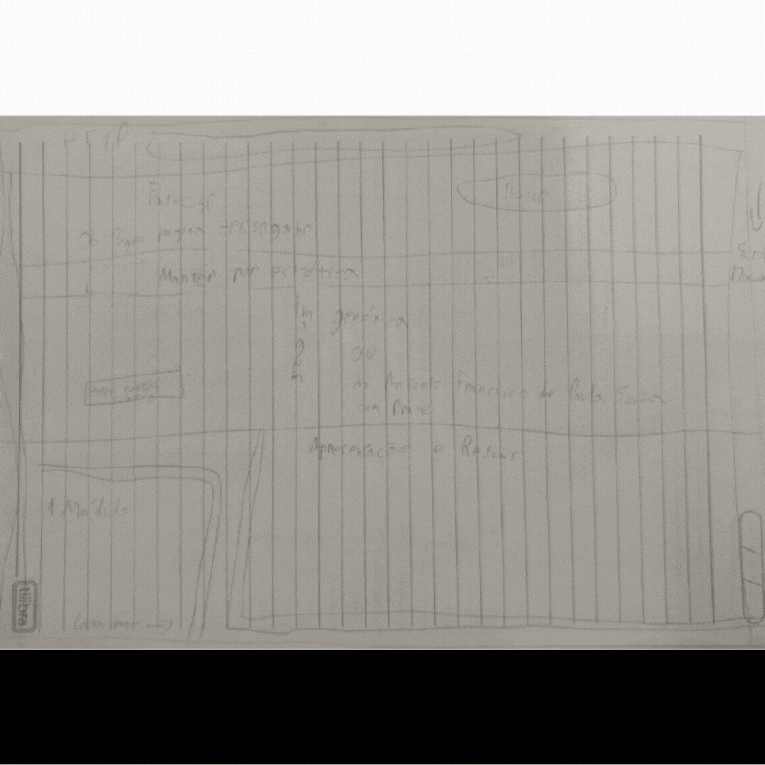
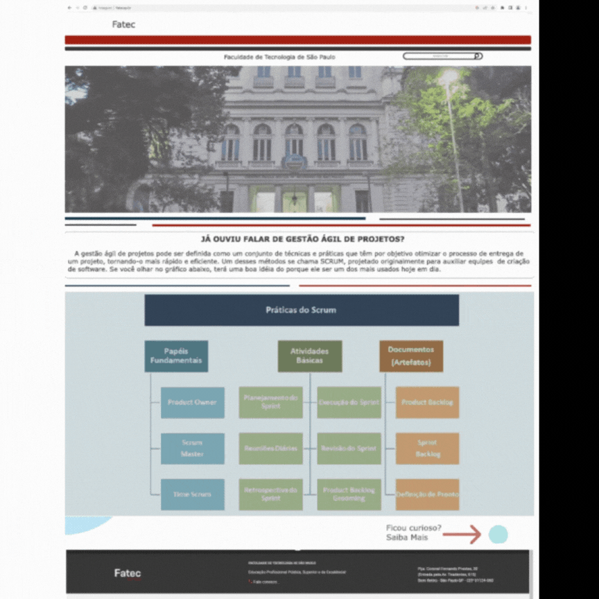
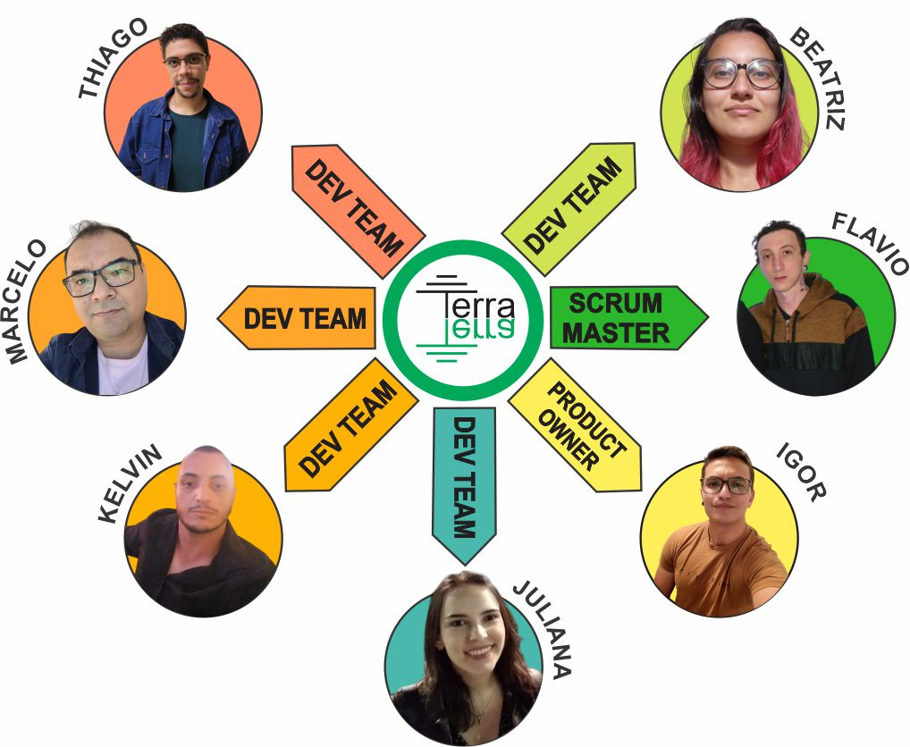

    

    

    <a href="#sobre">Sobre</a>  |  
    <a href="#backlogs">Backlogs</a>  |  
    <a href="#tecnologias">Tecnologias</a>  |  
    <a href="#equipe">Equipe</a>

    
    

    
## :bookmark_tabs: Sobre o projeto

O objetivo do projeto é desenvolver um sistema web que atenda às demandas do cliente, os quais foram especificados como a apresentação de todos os processos e artefatos da metodologia ágil Scrum, juntamente com recursos para provas de fixação. Além disso, o sistema deve ser intuitivo e de fácil usabilidade, a fim de promover uma experiência satisfatória para os usuários.

> _Projeto baseado na metodologia ágil SCRUM, procurando desenvolver a Proatividade, Autonomia, Colaboração e Entrega de Resultados dos estudantes envolvidos_
    

:pushpin: <a href="https://github.com/TerraSoftwarehouse/Documentacao/blob/main/README.md" class="botao" target="_blank"><strong>Documentação</strong></a>   

:pushpin: Status do Projeto: Finalizado ✅

### 🏁 Entregas de Sprints
Cada entrega foi realizada a partir da criação de uma branch neste repositório com um relatório completo de tudo o que foi desenvolvido naquela sprint. Observe a relação a seguir:
| Sprint | Previsão de entrega | Status           | Histórico |
|:--:|:----------:|:-------------------|:-------------------------------------------------:|
| 01 | 09/04/2023 | ✔️ Finalizada       |  [ver relatório](https://github.com/TerraSoftwarehouse/Sprint01) |
| 02 | 07/05/2023 | ✔️ Finalizada     | [ver relatório](https://github.com/TerraSoftwarehouse/Sprint02) |
| 03 | 06/06/2023 | ✔️ Finalizada   | [ver relatório](https://github.com/TerraSoftwarehouse/Sprint03) |

→ [Voltar ao topo](#topo)

## :dart: Backlogs
     

## 📅 Evolução do projeto:

## prototipos     
 
 

## pagina
- Finalmente, apresentamos a versão final do site, que possui conteúdo estruturado em módulos, foco na acessibilidade e a capacidade de gerar certificados. Essas funcionalidades permitem aos usuários um aprendizado personalizado e flexível, atendendo às suas necessidades individuais. Estamos orgulhosos de entregar um produto completo que promove a inclusão, a interatividade e reconhece o progresso dos usuários por meio dos certificados gerados.    
    
-     
 
-Durante o desenvolvimento do projeto, concluímos empiricamente a importância da adoção da metodologia Scrum. À medida que nos aprofundávamos no conhecimento e implementávamos as práticas, observamos melhorias significativas na organização do projeto e um aumento no engajamento da equipe. O Scrum se revelou uma abordagem eficaz para promover a colaboração e a entrega de resultados de alta qualidade.    
    
→ [Voltar ao topo](#topo)
    

## 🛠️ Tecnologias

As seguintes ferramentas, linguagens, bibliotecas e tecnologias foram usadas na construção do projeto:

    

 
 
 
 
 
    
    
    

    
→ [Voltar ao topo](#topo)

## :busts_in_silhouette: Equipe

    
     
    
    
    
    

    
    
|    Função     | Nome                                  |                                                                                                                                                      LinkedIn & GitHub                                                                                                                                                      |
| :-----------: | :------------------------------------ | :-------------------------------------------------------------------------------------------------------------------------------------------------------------------------------------------------------------------------------------------------------------------------------------------------------------------------: |
|   Product Owner    | Igor Vinicius Santos Fonseca |                        |
| Scrum Master  | Flavio Eduardo Linguanotto |             |
|   Dev Team    | Marcelo Eiji Torrieli                 |       |
|   Dev Team    |Juliana Maciel Manso                   |             |
| Dev Team |Kelvin Franco de Souza              |   | 
| Dev Team |  Beatriz Roberto Montanini  |   | 
| Dev Team | Thiago Marinho Brito de Souza    |   | 

    
→ [Voltar ao topo](#topo)

